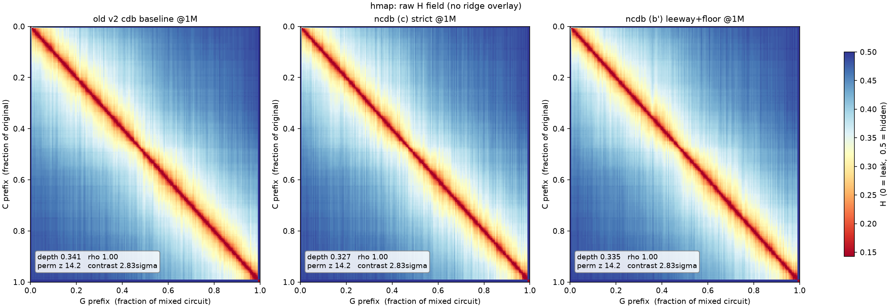
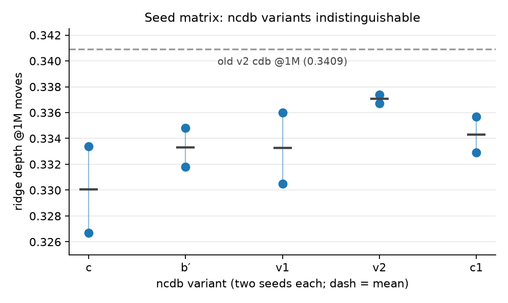
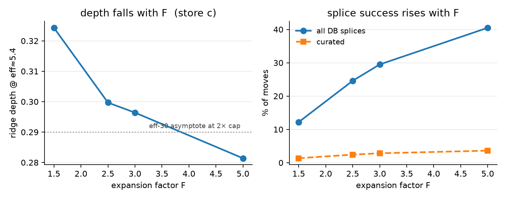
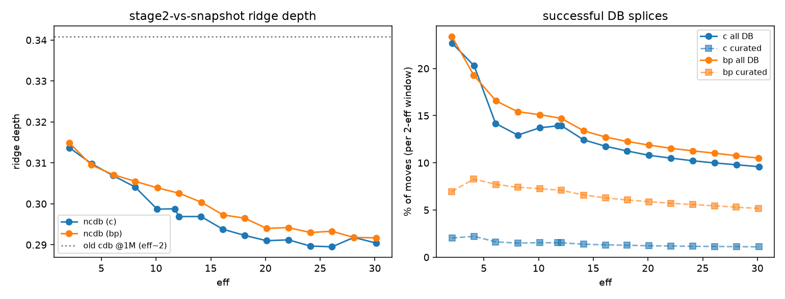

# The Curated Database: from the v2 Function-Keyed Store to the v3 True-Friend Store

*Summary of the 2026-09-28 … 10-02 redesign: old vs. new structure and operation,
the definitional variants, the experimental record, and the rationale for
continuing with modes (c) and (b′). Companion artifacts:
`CURATED_DB_FINDINGS.md` (the pre-redesign diagnosis),
`runs/ncdb_ab_20261001/RESULTS.md` (all experiment tables),
`runs/ncdb_random_20261001/RESULTS.md` (peer ablation runs).*

## 1. Setting

Stage 3 (`db_mixing`) replaces sampled windows of the circuit with equivalent
spellings drawn from two frozen stores: the **regular** store
(`frozen_m1_m11`, the complete g57 replacement corpus through 11 gates,
function-keyed) and the **curated** store, whose job is to offer
*meaningfully different* alternatives for a window — above all, equal-length
re-spellings that in-place mixing lives on. The redesign concerns only the
curated store; the regular store and the rest of the move loop are unchanged.

## 2. The old store (v2, function-keyed)

**Construction** (`build_curated_full from-frozen-identities-v2`):

1. For every multi-member class of the regular store (9.68M classes, i.e.
   functions with ≥ 2 stored spellings `a, b ≤ 11` gates), form the pair
   identity `a · rev(b)`, canonicalize, cancel adjacent duplicates.
2. Deduplicate identities by dihedral orbit (rotations × reversals of a
   cyclic word yield the same candidate set): 20.0M words → 7.47M orbits.
3. For each orbit word of length *n*: enumerate every direction × rotation ×
   split. Each split `P | S` emits **both** `P` and `rev(S)` under the
   **function key of the prefix** (canonical-polynomial hash); candidates are
   rewired into the prefix's canonical wire frame and gate-canonicalized.
4. Keep one lexicographic representative per (identity, key, gate count) —
   the "sibling collapse" — then byte-exact global dedup.

**Shape**: 15.55M keys / 276M candidates. Structural facts discovered during
the diagnosis: every pair identity simplifies to ≤ 12 gates (multi-member
classes concentrate at ≤ 6-gate members; the rare longer pairings cancel
away), hence candidates cap at 11 gates, **keys exist only for functions of
minimal length ≤ 6**, and long candidates pile up exclusively under
near-trivial keys (the single-gate key held 7.7M spellings, 245 MB; the
identity-function key 2.6M).

**Operation**: the mixer's curated-exhaust cascade probes the curated store
first, at every window length, by the window's **function** key (forward
direction); any stored spelling of that function is a candidate; the regular
store is consulted only on a complete curated miss.

**Why it failed** (`CURATED_DB_FINDINGS.md`):

* **F1 — the sibling collapse was wrong at the midpoint.** At the midpoint
  split, `P` and `rev(S)` are the two genuinely different halves (`a` and
  `b`); one was silently dropped. 48% of keys held a *single* candidate —
  usually the window itself — although a different same-length spelling
  provably existed for 95% of them.
* **F2 — no difference guarantee.** A key's pool mixed rotation debris,
  commuting re-spellings of the window, and the window itself. After the
  canonical-order identity guard landed (punchlist item 1), 43% of moves in
  the test run were re-spelling rejections (`reorder-idsk`).
* **F3 — catastrophic lookup cost.** Mean candidates per splice choice was
  327k–660k; selection was linear per retry; throughput fell from ~100k
  moves/min to ~100k moves per 30–60 min.
* **F4 — no provenance**: nothing recorded *why* a candidate was a good
  alternative for a window.

## 3. The new notion: true friends

The redesign replaces "any spelling of the window's function" with a
certified pairwise relation. With involutive gates, write `C* = C⁻¹ = rev(C)`.

**Strict definition.** `D` is a true friend of `C` (spellings of one
function `f`, `δ = minlen(f)`) when the closed loop `C·D*` is *locally
minimal except for a sanctioned chord* between its junctions ID and `P_f`:
for every pair of prefix-permutations `u, v` on the loop, the true Cayley
distance equals the arithmetic minimum over the four sanctioned routes (two
arcs along the loop; two routes through a δ-gate geodesic chord). The
per-circuit half of this — every window of `C` sits exactly on its
sanctioned routes — is **chord-tightness**; for a geodesic spelling it
reduces to classical local geodesicity, and for a non-minimal spelling it
allows exactly the slack the chord explains, no more. Consequences by
construction: the two prefix paths never re-meet away from the junctions, so
self-pairs and all commuting reorders are excluded (F2 dies definitionally);
the identity-function key cannot exist; provenance is the definition (F4).

**Relativized routes.** When the *key* circuit is not required to be tight
(below), junction routes are priced with proven distances of its actual
prefixes rather than raw gate counts — this is exactly the original
"shortest path through ID or `P_C`" phrasing, and it coincides with the
arithmetic form on tight circuits.

**Leeway.** A graded relaxation lets a check miss its sanctioned minimum by
at most *t* gates, with *t* = 2 for pair total length ≥ 9, *t* = 1 for 7–8,
else 0.

**The oracle.** Distances are decided by a layered oracle: exhaustive exact
tables for minlen ≤ 3 (all 1/2/3-gate words up to relabelling — 1 + 31 +
1,639 functions, cross-validated against the pool census), plus
regular-store members as shortcut witnesses. Checks with threshold ≤ 4 are
exact; above that, "pass" means *no shortcut witnessed* — the same evidence
the replacement-db adversary holds. This layering was forced by a
discovery: the regular store is a replacement table, **not** a minimality
oracle — e.g. the single-gate function's class stores only 5- and 6-gate
re-spellings.

## 4. The new store (v3 "ncdb", circuit-keyed)

**Pools.** The v2 enumeration re-ran *without* the sibling collapse
(`from-frozen-identities-v3-pools`): same 7.47M identities, all
exact-distinct arcs kept — 779.2M candidates over the same 15.55M function
keys, **zero single-candidate pools** (F1 fixed at the source).

**Pairs.** A single pass over the pools (reservoir ≤ 48 members per pool ×
length, ≤ 2,500 pairs per pool; pools ≤ 64 members — 96% of keys — are
exhaustive) evaluates every sampled pair once under the layered oracle and
emits each qualifying *ordered* pair `(C → D)` into per-mode stores:

| mode | key `C` | friend `D` | cross checks | keys | pairs |
|---|---|---|---|---|---|
| a | tight | tight | exact | 0.44M | 0.83M |
| **c** | **unconstrained** | **tight** | **exact** | **1.96M** | **3.30M** |
| v2 | unconstrained | slack ≤ t, small windows exact | exact | 2.54M | 5.12M |
| c1 | unconstrained | as b′, all leeway capped at 1 | ≤ 1 | 4.33M | 9.42M |
| v1 | unconstrained | tight | ≤ t | 12.05M | 28.0M |
| **b′** | **unconstrained** | **slack ≤ t, windows ≤ 4 exact** | **≤ t** | **16.87M** | **63.1M** |
| b | unconstrained | slack ≤ t | ≤ t | 18.73M | 194.2M |

Containments: a ⊆ c ⊆ {v1, v2, c1} ⊆ b′ ⊆ b (as ordered-pair sets).
"Unconstrained key" is the deliberate asymmetry: a junky window *should* be
replaceable by a certified friend; the relation is therefore directed, and
splices drift toward tight material.

**Record format and keys.** A record is
`xxh3_128(canonical circuit blob of C) ‖ blob of D`: the key is the
**circuit**, not the function — different spellings of one function are
different keys, each owning only its certified friends, stored in the same
canonical wire frame the function key would induce (so the runtime decode
path is unchanged). Stores are direction-complete (both `C` and `rev(C)`
appear as keys; no min-direction fold — the regular store's fold trades
runtime cost for 160 GB, a trade that reverses at ncdb sizes). Friend lists
are small by construction: (c) median 1 friend/key (mean 1.68, max ~64),
(b′) median 2 (mean 3.74, max ~128).

**Runtime.** `FROZEN_CURATED_KEY=circuit` switches the curated stage (and,
since 10-01, the leakage-repair QC path) to the circuit key, computed by
`circuit_key_of_window` — byte-identical to the builder's framing, with a
round-trip-verified g57 encoder so non-g57 windows fail closed to a miss.
Everything else (decode, selection, guards, splice) is untouched. Misses are
the common case and cost a Bloom-filter probe (~0.39% FP). The identity
guard stack remains armed as defense in depth but curated candidates can no
longer trip it.

## 5. The experimental record

* **Probe (sampled, oracle-exact).** Pool material is ~85% tight at the
  short/geodesic end but 2.5–3.5% at 7 gates and ~0% at 9–11 gates
  (junction-crossing arcs are shortcut-ridden) — most of the 779M-candidate
  mass is dead weight under any mode. Among tight pairs, strict passes are
  rare over hard functions (~0.8% at (6,6), δ = 6) and plentiful over easy
  ones (~80% at (5,5), δ ≤ 2). The (b)-vs-(b′) gap at ≥ 6-gate friends is
  almost entirely friends carrying compressible ≤ 4-gate windows — visible
  junk — which is what motivated the b′ floor.
* **Full-profile A/B** (mini-sandwich TDP, 3.65M moves, same seed/binary):
  both arms finished in **27 min** (the v2-store runs needed > 1 day per 1M
  moves and were killed). Mean candidates per choice 1.5–2.2 (vs 327k);
  identity-skips at matched 700k moves: 232k/224k vs 311k (old baseline) and
  593k (old fixed); curated splices are two-thirds equal-length — 22k 4↔4 +
  27k 5↔5 for (c); 163k 5↔5 for (b′) — the move class v2 could not honestly
  serve at all.
* **Ridge vs the old store** (stage-2 rows vs 1M-move states, identical
  grids): old 0.3409; ncdb (c) 0.3267/0.3334 (two seeds), (b′)
  0.3348/0.3318.

* **Seed-replicated matrix** (5 stores × 2 seeds at 1M): within-store seed
  spread 0.003–0.007 equals every between-store gap — **no ncdb variant
  separates from any other**; the robust fact is 10/10 ncdb runs below the
  old store's depth.

* **Expansion-factor sweep** (profile 3,5,5,F,F on (c)): depth falls and
  splice success rises monotonically — F = 1.5/2.5/3/5 → depth
  0.3243/0.2997/0.2964/0.2814, DB-splices 12.2/24.6/29.5/40.5% of moves.
  6–14× seed noise: the one strong lever found, re-confirming "r is the
  master knob"; F = 5 at eff 5 already beats the next item's asymptote.

* **Long holds to eff 30** (2× cap, 41.9M moves/arm): (c) and (b′)
  identical at every point (0.314 → 0.290 vs 0.315 → 0.292), hard
  deceleration to an asymptote ≈ 0.290 (the known ~0.28 floor's
  neighborhood); splice traffic decays 23% → 10% of moves while curated's
  *share* grows all run (b′: 30% → 49% of DB splices — causal self-seeding,
  later confirmed by the curated-only experiment).

* **Peer ablation runs** (`runs/ncdb_random_20261001`, 10-02): on random
  material, removing the cdb entirely — or forcing every MIX splice through
  it at matched splice budget — leaves ridge depth unchanged (max Δ 0.0035 <
  seed spread). **Affine-ridge depth is pure dilution and is not the axis on
  which any curated store differentiates**; the follow-on erasability work
  shows the floor is governed by the input's hull-erasability instead. The
  cdb's value therefore rests on what these experiments did measure:
  correctness of served material, certified equal-length traffic for TDP
  vocabulary, bounded per-key cost, and ~50× throughput.

## 6. Why (c) and (b′)

* **(a) is strictly dominated by (c).** Every (a)-pair is in (c) with the
  identical per-pair guarantee; (c) additionally serves junky keys — the
  common case in a mixed circuit, and the population the old store punished
  with self-hits. There is no hypothesis (a) can test that (c) cannot.
* **(b) is dominated by (b′).** Its extra 131M pairs are precisely friends
  whose small windows compress by 1–2 gates — splicing visibly cancellable
  junk. The probe showed entire cohorts (e.g. the single-gate pool's 7-gate
  friends) exist only through that hazard; no measured benefit offsets it.
* **(c) vs (b′) isolates the one real dial.** They share key policy
  (unconstrained) and small-window hygiene (exact ≤ 4), and differ only in
  the graded leeway on spread and large windows — strictest-certified vs
  maximal-certified-clean, 3.3M vs 63.1M pairs, 1× vs ~5× curated traffic.
  The intermediates built to interpolate (v1, v2, c1) were measured in the
  seed matrix and separate from neither pole, so they add storage without
  adding information.
* **Empirically interchangeable, operationally distinct.** On every security
  metric tried they tie (and the ablation result says the ridge cannot
  prefer either); so the choice is structural: **(c)** when the store should
  assert the purest guarantee at minimal size (68 MB composite), **(b′)**
  when curated-move volume matters (TDP digestion, self-seeding studies,
  COMP-side traffic). Both frozen stores are validated, filtered, and
  interchangeable per run via `FROZEN_CURATED_DIR`.

## 7. Artifacts and state

Stores under `frozen_db/`: pools `curated_pools_v3_20260929`; composites
`tf_v3_{a,c,b,bp,v1,v2,c1}_*`; frozen `frozen_tf_{c,bp,v1,v2,c1}_*` (+
filters). Tools (working tree, uncommitted): `from-frozen-identities-v3-pools`,
`pool_census`, `true_friend_probe` (probe + 7-mode builder + layered oracle),
runtime circuit-key switch + tests, `curves.py`/watchers under
`runs/ncdb_ab_20261001/`. Known open items: the `--tdp` preset stomps
`--no-curated*` (flag-pair workaround, unfixed); uploads of the new stores to
object storage (PUNCHLIST 3/7) pending; identity-function pool excluded by
policy — revisit only with a δ = 0 story.
